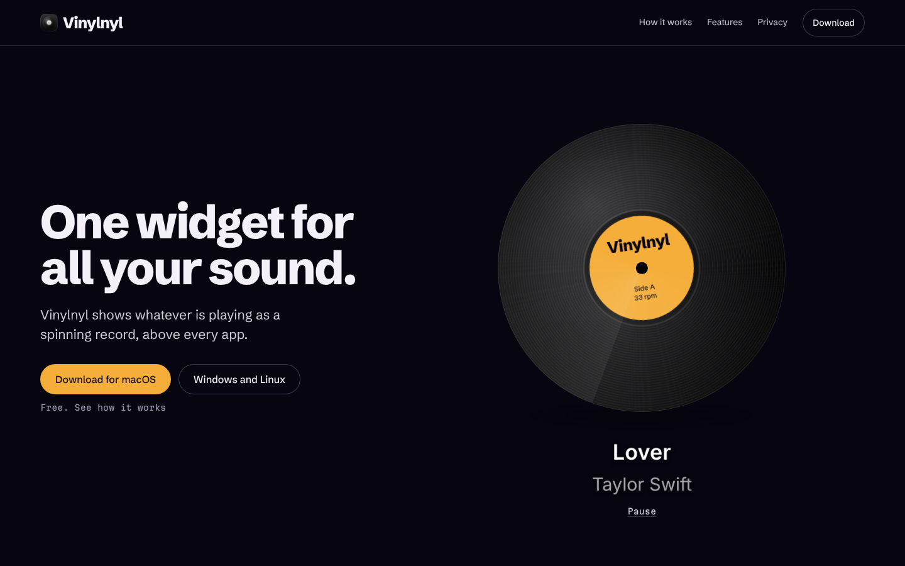

# Vinylnyl

A desktop widget that shows whatever is playing as a spinning vinyl record, floating above every app.
Works with YouTube, YouTube Music, Spotify and more on macOS, Windows and Linux. Free, fully local, no account.



## Install

Download from [Releases](https://github.com/scrawl-labs/vinylnyl/releases/latest):

| OS | File |
|---|---|
| macOS 12+ | `Vinylnyl.dmg` |
| Windows 10+ | `Vinylnyl-Setup.exe` |
| Linux | `Vinylnyl.AppImage` |

- **macOS:** in Safari or a Chrome-based browser, turn on Develop → **Allow JavaScript from Apple Events**, then allow the automation prompt.
- **Linux:** install `playerctl`.
- The app isn't code-signed yet. On macOS use System Settings → Privacy & Security → **Open Anyway**; on Windows click **More info → Run anyway**.

## Structure

```
electron-widget/   the widget app (Electron)
extension/         optional browser extension (Firefox, sharper track info)
landing-page/      the website
```
